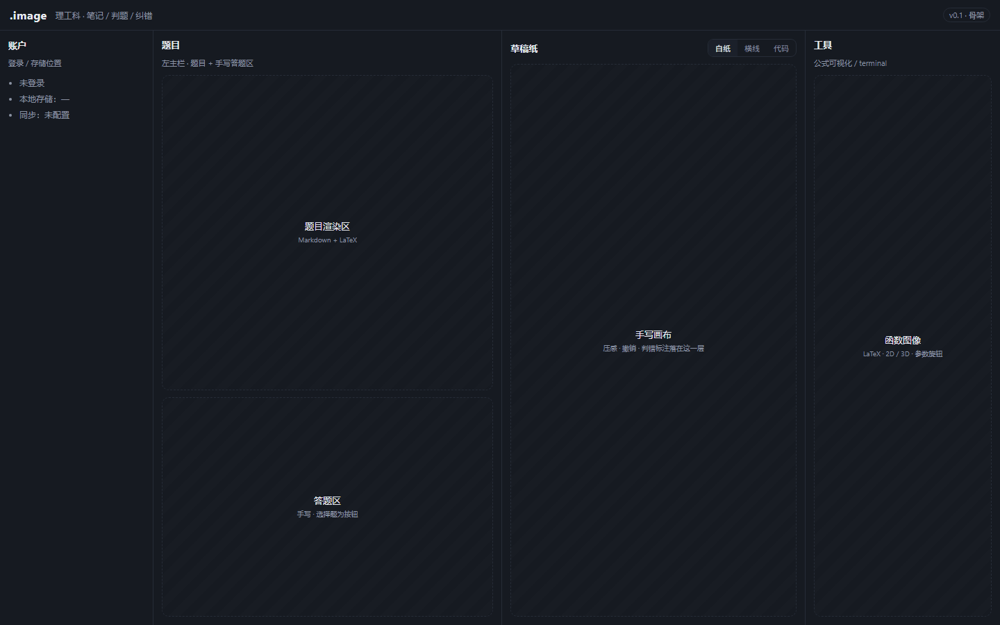

# .image

> 读作 "dot image"

理工科学生的 **手写笔记 / 判题 / 纠错** 三合一软件。

左侧看题、右侧在草稿纸上演算；提交后 AI 判分，**答错时直接在草稿纸上标出「从哪一步开始错」**——而不是只打一个红叉。

- **双端**：Windows 桌面 + Android 平板（Chromium 一套前端，桌面 Electron / 平板 Capacitor）
- **手写优先**：白纸 / 稀疏横线 / 代码页，三种草稿纸；压感笔迹 + 可回放
- **模型可换**：客户端直连，自带 API Key（BYOK），任意 OpenAI 兼容的多模态模型
- **离线可用**：选择题 / 填空题本地判分；做题、翻错题不联网

> 状态：**早期开发中**。当前仓库是工程骨架（四栏 UI），产品方案见 [docs/plan.md](docs/plan.md)。

## 界面：1 + 2 + 1 栏

```
┌────┬──────────────┬──────────────┬────┐
│ -1 │      1       │      2       │ +1 │
│账户│  题目+答题区  │  草稿纸/代码页 │工具 │
└────┴──────────────┴──────────────┴────┘
```

| 栏位 | 职责 |
| --- | --- |
| **-1 左栏** | 登录、账号、存储位置 |
| **1 左主栏** | 题目展示 + 手写答题区（选择题为按钮） |
| **2 右主栏** | 草稿纸（手写）或代码页（机器字） |
| **+1 右栏** | 公式可视化（LaTeX / 3D 函数图）、terminal |



## 核心流程

1. 出题 → 学生在左栏答题、右栏草稿纸演算
2. 提交 → AI 判分（选择/填空走本地答案，大题走视觉模型）
3. 答错 → 在草稿纸上 **in-line 标注第一个出错的步骤**（+ 可选提示按钮）
4. 存档 → 草稿转为只读位图，错题进错题本

## 开发

要求：Node.js ≥ 24、npm ≥ 11

```bash
npm install
npm run dev        # 启动桌面端（Electron + Vite）
npm run build      # 构建
```

目录结构：

```
apps/desktop       Electron + React + TypeScript 桌面客户端
docs/plan.md       产品与技术方案（数据模型、判题链、成本估算）
```

## 路线图

- [x] 四栏 UI 骨架
- [ ] 手写草稿纸（压感、撤销、三种纸型、笔迹存档）
- [ ] 题库（本地 SQLite）与录入（PDF/Word/OCR → ipynb 兼容格式）
- [ ] 判题链（步骤切分 → 视觉模型 → 首个错点标注）
- [ ] 账号与双端同步
- [ ] Android 平板壳（Capacitor）

## 许可

[MIT](LICENSE)
